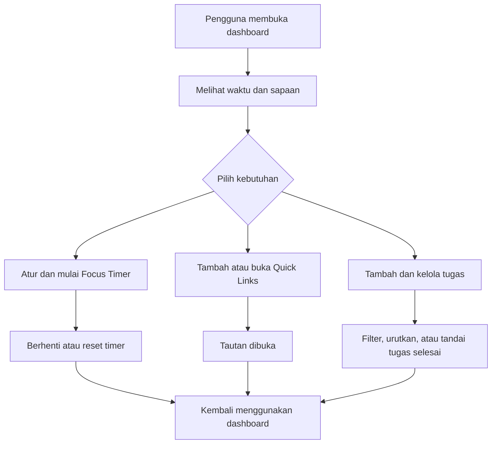

# CodingCamp-2November26-Bagus

## Deskripsi

**Coding Camp Life Dashboard** adalah situs sederhana untuk membantu peserta Coding Camp mengatur kegiatan belajar dan menjaga fokus. Dalam satu halaman, pengguna dapat melihat waktu dan sapaan, mengatur timer fokus, menyimpan tautan penting, serta mencatat dan mengelola daftar tugas.

Situs ini dibuat dengan HTML, CSS, dan JavaScript, sehingga dapat digunakan langsung melalui browser tanpa instalasi atau akun.

## Fitur

- **Sapaan dan waktu:** menampilkan jam, tanggal, dan sapaan; pengguna dapat memasukkan nama.
- **Mode tema:** beralih antara tampilan terang dan gelap.
- **Focus Timer:** menjalankan, menghentikan, dan mengatur durasi timer.
- **Quick Links:** menyimpan tautan yang sering digunakan.
- **Daftar tugas:** menambah tugas, menandai tugas selesai, memfilter, mengurutkan, dan menghapus tugas yang selesai.
- **Desain responsif:** halaman menyesuaikan ukuran layar perangkat.

## Alur penggunaan

## Teknologi

- HTML
- CSS
- JavaScript

## Menjalankan secara lokal

1. Unduh atau clone repository ini.
2. Buka `index.html` di browser.

## Deploy dengan GitHub Pages

1. Buka repository di GitHub.
2. Pilih **Settings → Pages**.
3. Pada **Build and deployment**, pilih **Deploy from a branch**.
4. Pilih branch `main` dan folder `/ (root)`, lalu klik **Save**.
5. Tunggu proses publikasi selesai. URL situs akan ditampilkan di halaman **Settings → Pages**.

File utama situs: `index.html`, `css/style.css`, dan `js/script.js`.
